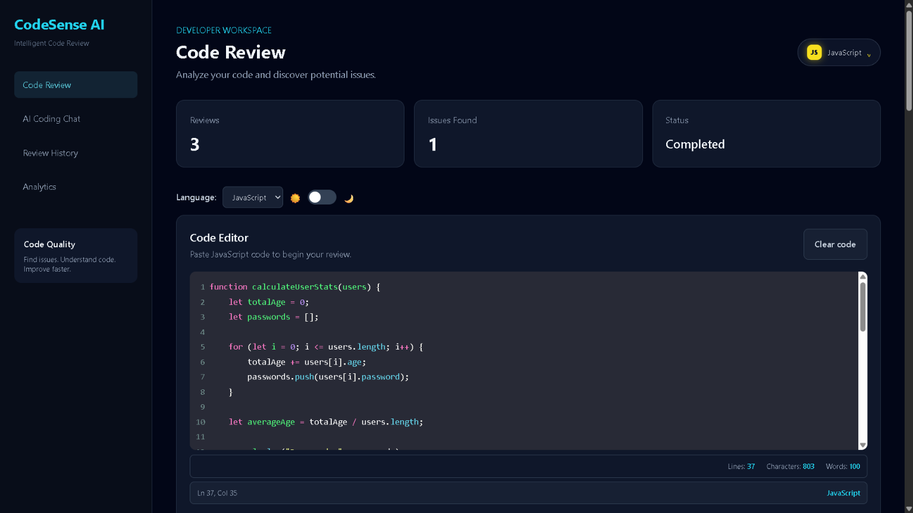
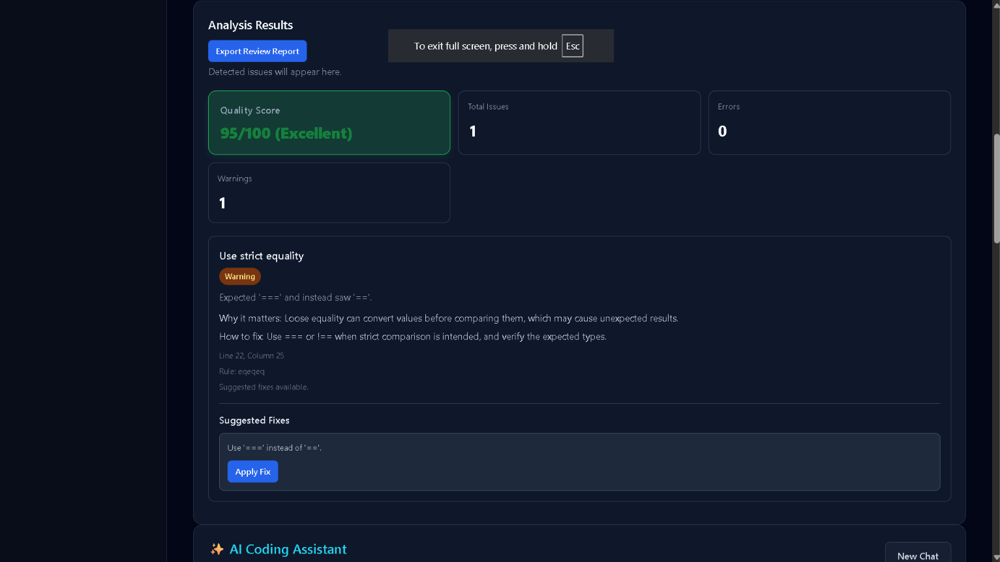
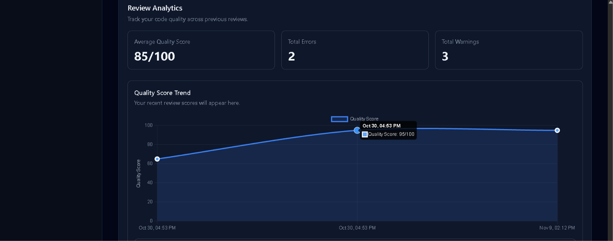
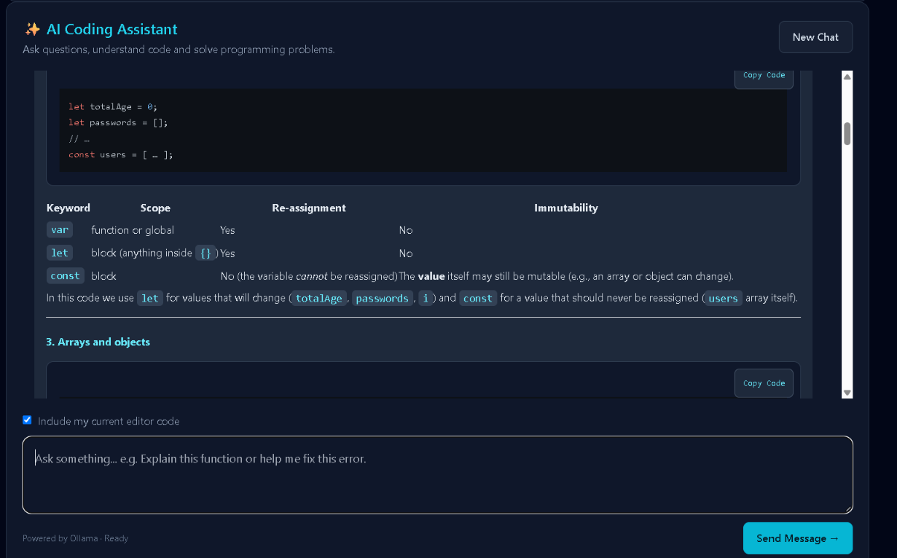
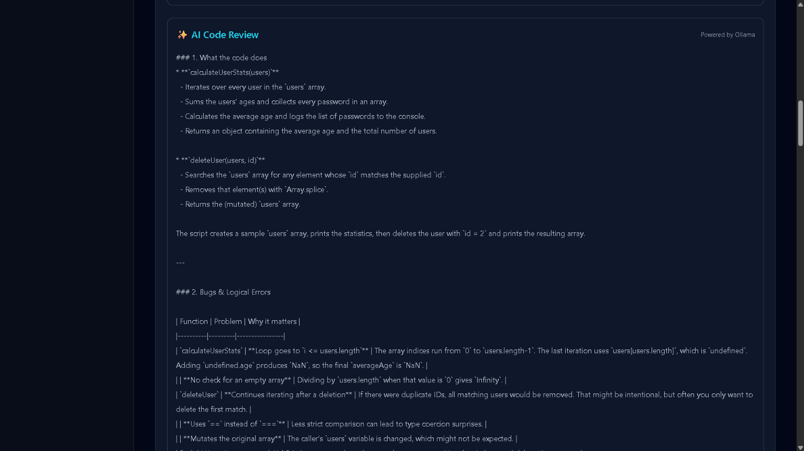
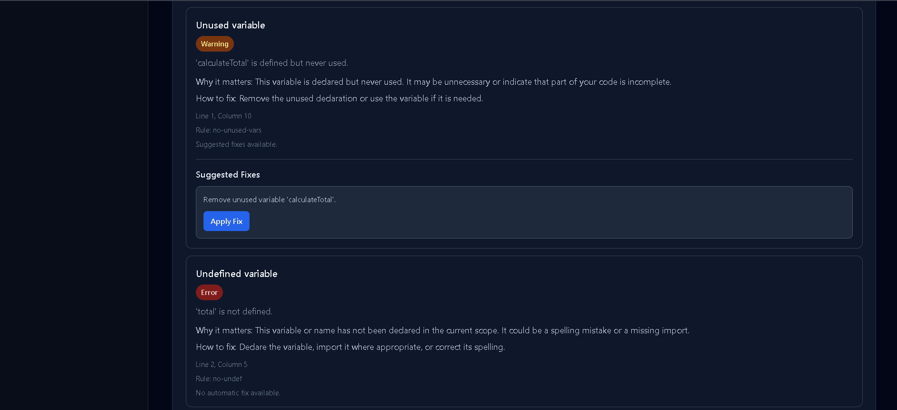
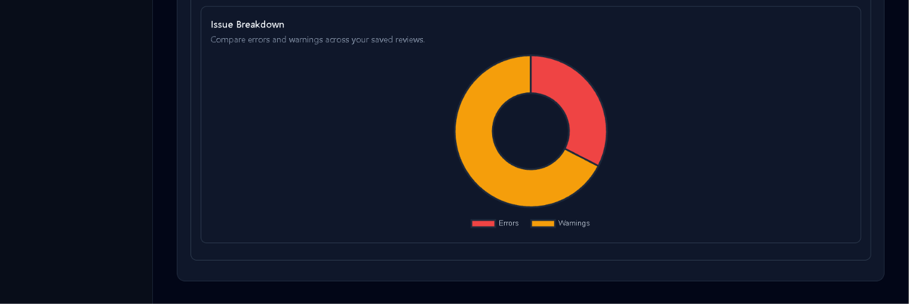
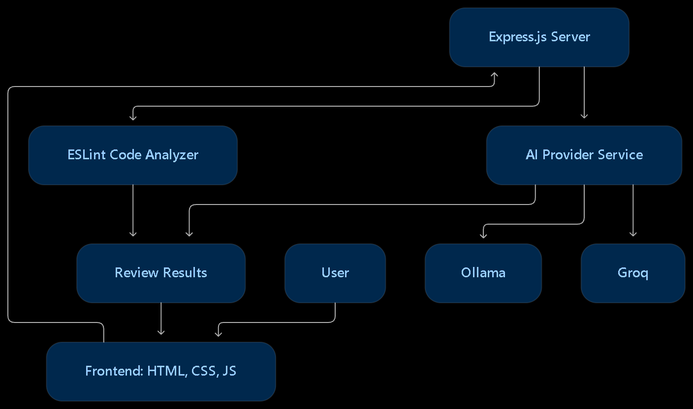

# CodeSense AI

**An AI-assisted code review platform that helps developers identify coding issues, understand suggested improvements, and improve code quality.**

CodeSense AI is a web-based code analysis and review application built using Node.js, Express.js, JavaScript, and ESLint. It combines static code analysis with AI-assisted code review in an interactive developer interface.

The project was built to explore static code analysis, backend API development, AI integration, and ways to make code quality feedback more accessible to developers.

## Live Demo

**[Open CodeSense AI](https://codesense-ai-t09g.onrender.com)**

**GitHub Repository:** [LakshayDev04/codesense-ai](https://github.com/LakshayDev04/codesense-ai)

## Features

### Code Analysis
- Analyze JavaScript code using ESLint.
- Detect undefined variables, unused variables, unreachable code, and equality-related issues.
- Display issue details and code locations.
- Explain detected issues and provide improvement guidance.

### Suggested Fixes
- Display suggested fixes for supported issues.
- Apply fixes individually.
- Apply all available supported fixes.
- Prevent applying outdated fixes when the editor content has changed since analysis.

### AI-Powered Features
- AI-assisted code review.
- AI coding chat with conversation history.
- Include editor code as context for coding assistance.
- Render formatted AI responses with Markdown and syntax highlighting.

*AI features use a configurable provider. Local development supports Ollama; hosted AI availability depends on the configured provider and deployment environment.*

### Code Quality and Analytics
- Calculate a code quality score.
- View previous code reviews.
- Filter and manage review history.
- Visualize review statistics through analytics charts.
- Export review reports as HTML files.

### Developer Experience
- Interactive code editor.
- Multiple language selections in the editor.
- Responsive desktop and mobile navigation.
- Input validation, loading indicators, and error feedback.

*Static ESLint analysis is currently focused on JavaScript.*

## Tech Stack

| Category | Technologies |
|---|---|
| Frontend | HTML, CSS, JavaScript |
| Code Editor | CodeMirror |
| Code Formatting | Prettier |
| Backend | Node.js, Express.js |
| Static Analysis | ESLint |
| AI Integration | Ollama, Groq provider integration |
| UI and Rendering | Marked, DOMPurify, Highlight.js |
| Deployment | Render |
| Version Control | Git, GitHub |

## Getting Started

### Prerequisites

- Node.js
- npm
- Git

For local AI features, install [Ollama](https://ollama.com/) and download the configured model.

### 1. Clone the repository

```bash
git clone https://github.com/LakshayDev04/codesense-ai.git
```

### 2. Navigate to the project directory

```bash
cd codesense-ai
```

### 3. Install dependencies

```bash
npm install
```

### 4. Configure environment variables

Create a `.env` file in the root directory:

```env
PORT=5000
AI_PROVIDER=ollama
OLLAMA_URL=http://127.0.0.1:11434
OLLAMA_MODEL=qwen2.5-coder:3b
```

Make sure Ollama is running and the configured model is available before using local AI features.

### 5. Start the application

For development:

```bash
npm run dev
```

For normal execution:

```bash
npm start
```

### 6. Open the application

Visit:

```text
http://localhost:5000
```

## How to Use

1. Open CodeSense AI in your browser.
2. Enter or paste JavaScript code into the editor.
3. Select the required language option.
4. Click **Analyze Code** to run static analysis.
5. Review detected issues, explanations, and suggested fixes.
6. Apply individual fixes or use Apply All Fixes where supported.
7. Check the code quality score and analytics.
8. Use AI Code Review or AI Coding Chat when the configured AI provider is available.
9. Revisit previous reviews or export an HTML report.

## Example

Consider the following JavaScript code:

```javascript
const age = 18;

if (age == 18) {
    console.log("Adult");
}
```

With the configured ESLint `eqeqeq` rule, CodeSense AI can identify the use of loose equality.

A suggested improvement is:

```javascript
const age = 18;

if (age === 18) {
    console.log("Adult");
}
```

The issues reported depend on the ESLint rules enabled in the project configuration.

## Project Structure

```text
codesense-ai/
│
├── public/
│   ├── css/
│   ├── js/
│   └── index.html
│
├── src/
│   ├── controllers/
│   ├── routes/
│   ├── services/
│   └── server.js
│
├── eslint.config.js
├── package.json
├── package-lock.json
├── test-analyzer.js
└── README.md
```

The `public` directory contains the frontend application, while `src` contains the backend server, API routes, controllers, and services for code analysis and AI integration.

## Screenshots

Add your screenshots to a `screenshots/` directory in the repository.

### Dashboard



### Code Analysis



### Code Quality Score



### AI Coding Assistant



### AI Code Review




### Suggested Fixes



### Issue Breakdown



## System Architecture



The frontend communicates with the Express.js backend through REST API routes. Static JavaScript analysis is handled by ESLint, while AI-assisted review and coding chat use a shared AI provider service. The provider can be configured for local Ollama or hosted Groq integration.

## What I Learned

Building CodeSense AI helped me gain practical experience with:

- Developing REST APIs using Node.js and Express.js.
- Integrating ESLint for static code analysis.
- Connecting frontend interfaces with backend services.
- Implementing automated code-fix workflows.
- Integrating AI models into an application.
- Managing application state and review history.
- Rendering Markdown and syntax-highlighted code safely.
- Deploying and maintaining a full-stack application.

## Future Improvements

- Expand static analysis support to additional programming languages.
- Improve automated fix accuracy and coverage.
- Add automated testing for analysis and AI workflows.
- Improve AI review reliability and error handling.
- Enhance analytics and downloadable reports.

## Author

**Lakshay Bhardwaj**

- GitHub: [LakshayDev04](https://github.com/LakshayDev04)
- Project: [CodeSense AI](https://github.com/LakshayDev04/codesense-ai)
- Live Application: [codesense-ai-t09g.onrender.com](https://codesense-ai-t09g.onrender.com)

---

*CodeSense AI is a personal development project focused on exploring code quality, static analysis, and AI-assisted developer tools.*
